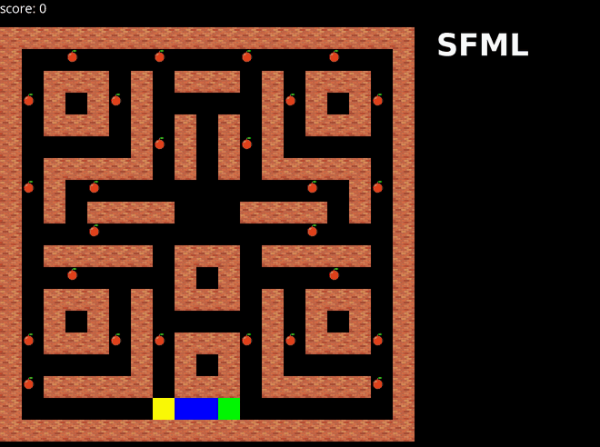
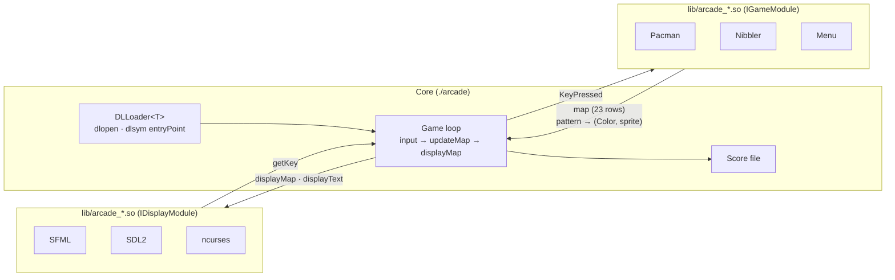

<div align="center">

# Arcade: a plugin-based retro gaming platform in C++

**Swap the graphics library or the game at runtime, without restarting: every renderer and every game is a shared library loaded on the fly.**




[Quick start](#quick-start) · [How it works](#how-it-works) · [Write your own plugin](#write-your-own-plugin) · [Documentation](#documentation)

</div>

---

## About

Arcade is the Object-Oriented Programming project of Epitech's second year. The brief: build a gaming platform where the **core**, the **graphics libraries** and the **games** are strictly separated, so that any of them can be replaced by a `.so` dropped into `lib/` under one of the standard library names, including libraries written by other student groups against the same interfaces.

The result is a small engine that runs **Pacman** and **Nibbler** (a Snake variant) on three interchangeable renderers, **SFML**, **SDL2** and **ncurses**, and lets you hot-swap between them with a single key while the game keeps running.

## Highlights

- **Dynamic loading with `dlopen` / `dlsym`**: a templated `DLLoader<T>` resolves the `entryPoint()` symbol of each plugin and wraps it in a `std::unique_ptr`, so the core never links against a renderer or a game at compile time.
- **Two minimal interfaces, `IGameModule` and `IDisplayModule`**: games expose a text map plus a pattern-to-sprite table, renderers draw it. A game knows nothing about pixels, a renderer knows nothing about rules.
- **Hot swap at runtime**: next or previous renderer, next game, back to the menu, restart, all without leaving the program.
- **Cross-group compatibility**: the interfaces were agreed with another Epitech team, and their sprites are supported by our SDL2 renderer.
- **Persistent scores** per game: every finished run is appended with the player name to a hidden `.<game>.scores` file and listed next to the game.
- **Graceful failure**: a missing or incompatible library throws a typed `Error` instead of crashing, and the program exits with Epitech's expected 84 code.

## Quick start

### Prerequisites

| Library | Debian / Ubuntu package |
|---------|-------------------------|
| SFML 2.x | `libsfml-dev` |
| SDL2 with ttf and image | `libsdl2-dev libsdl2-ttf-dev libsdl2-image-dev` |
| ncurses | `libncurses-dev` |

### Build and run

```bash
git clone https://github.com/yanishk/arcade.git
cd arcade
make            # builds ./arcade, lib/arcade_*.so for games and renderers
./arcade lib/arcade_sfml.so
```

`make core`, `make games` and `make graphicals` build each part separately.

### Controls

| Key | Action |
|-----|--------|
| Arrows | Move |
| Enter | Select a game or a renderer in the menu |
| N / P | Next / previous graphics library (in game) |
| G | Next game (in game) |
| M | Back to the menu |
| R | Restart the current game |
| Backspace or closing the window | Quit |

## How it works



Each frame, the core asks the current game for its map (an array of 23 strings where every character is a pattern) and a table mapping each pattern to a colour and an optional sprite path. The renderer then draws the map the way it can: ncurses uses the colour, SFML and SDL2 use the sprite when one is given and a coloured block otherwise. Input flows the other way as a `KeyPressed` enum, so games are written once and work on every renderer.

```
core/        Core loop, DLLoader, library discovery in lib/
display/     IDisplayModule and the three renderers (one Makefile each)
games/       IGameModule, Pacman, Nibbler and the Menu
include/     Shared enums: Color, KeyPressed, GameStatus, Error
assets/      Sprites and fonts
doc/         Technical documentation and class diagram (PDF), demo GIF
```

## Write your own plugin

A plugin is a class implementing `arcade::IGameModule` or `arcade::IDisplayModule`, compiled as a shared library, exposing one C symbol:

```c++
extern "C" {
    arcade::MyGame *entryPoint() {
        return new arcade::MyGame;
    }
}
```

Name it after one of the libraries the core recognises (the list shared by all groups, in [`core/Core.cpp`](core/Core.cpp): `arcade_snake.so`, `arcade_qix.so`, `arcade_centipede.so`, `arcade_solarfox.so` for games, `arcade_opengl.so`, `arcade_allegro5.so`, `arcade_qt5.so`… for renderers) and drop it in `lib/`: the core scans `lib/` for those names at startup and the menu picks it up. A file with any other name is ignored. The reference for both interfaces is their headers, [`games/IGameModule.hpp`](games/IGameModule.hpp) and [`display/IDisplayModule.hpp`](display/IDisplayModule.hpp); [`doc/Documentation_Arcade.pdf`](doc/Documentation_Arcade.pdf) explains each method but predates sprite support (its `getPattern()` and `init()` still map a pattern to a bare `Color`).

## Documentation

| Topic | Where |
|-------|-------|
| Interfaces and enums (current) | [`games/IGameModule.hpp`](games/IGameModule.hpp), [`display/IDisplayModule.hpp`](display/IDisplayModule.hpp), [`include/`](include/) |
| Method-by-method walkthrough (written before sprite support) | [`doc/Documentation_Arcade.pdf`](doc/Documentation_Arcade.pdf) |
| Class diagram | [`doc/Arcade_Diagram.pdf`](doc/Arcade_Diagram.pdf) |

## Team

Built in three weeks (March to April 2024) by two Epitech students:

| | Main areas |
|---|---|
| [**Yanis Harkouk**](https://github.com/yanishk) | Nibbler gameplay, Pacman gameplay (ghosts, scoring, win conditions), shared interfaces and enums, error handling and exit codes, build system, ncurses colour rendering, score persistence and player name, support for the other group's sprites in SDL2, interface docs |
| [**Eva Legrand**](https://github.com/Chaegnal) | Initial architecture, DLLoader and runtime switching between libraries and games, menu, map and sprite rendering in SFML and SDL2, Pacman and Nibbler groundwork (structure, maps), technical documentation (PDFs) |

Interfaces shared with Wilson Bordichon, Bradley Malbrouck and Mathis Brehm's group for cross-compatibility.

## License

Educational project (Epitech, 2024). Pacman and Nibbler are trademarks of their respective owners; this is a non-commercial, academic reimplementation.
